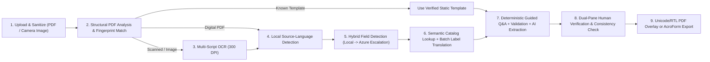

# AI & Document Processing Pipeline

This document specifies the end-to-end document ingestion, understanding, multilingual Q&A, LLM integration, and PDF generation architecture for **AI Form Assistant**.

---

## 1. End-to-End Processing Stages



---

## 2. Document Ingestion & Normalization (`app/documents/`)

| Format | Support Tier | Pipeline Behavior |
| :--- | :--- | :--- |
| **Digital AcroForm & Flat PDFs** | Production (v1.0) | Magic-byte `%PDF` check, empty-password decryption (`cryptography`), max `10 MB` / `20` pages, in-place neutralization of `/JavaScript`, `/OpenAction`, `/AA`, `/Launch`, and `/EmbeddedFiles`, SHA-256 checksum, private UUID object storage. |
| **Scanned Multi-Page PDFs** | Production (v1.0) | Routed automatically to `OCRService` (`300 DPI` render -> multi-script Tesseract `deu+eng+fra+ara+tur+ukr+spa`), never assuming `userLanguage == sourceLanguage`. |
| **Smartphone Camera Images (`JPG/PNG/WebP`)** | Commercial v1.0 (`Phase S1`) | Validated via `Pillow`, stripped of EXIF/GPS metadata, auto-oriented, and normalized into an A4 PDF at upload so all downstream OCR, detection, preview, and coordinate-overlay stages remain unified. |
| **DOCX** | Deferred (v1.3+) | Rejected cleanly with instructions to export as PDF first (avoids 600 MB headless LibreOffice attack surface for <2% of administrative volume). |

> [!WARNING]
> **Library Licensing Note:** `PyMuPDF` (`fitz`) is licensed under `GNU AGPL-3.0`. If the SaaS codebase is later made closed-source without a commercial Artifex license, replace the 4 `fitz` touchpoints with permissive-licensed `pypdfium2` (`Apache-2.0`/`BSD-3`), `pdfplumber` (`MIT`), `ReportLab` (`BSD-3`), and `pypdf` (`BSD-3`).

---

## 3. Document Understanding & Confidence Routing (`app/field_detection/`)

1. **Local-First Hybrid Detection (`HybridFieldDetectionProvider`):**
   - Runs `LocalFieldDetectionProvider` first at zero marginal cost (AcroForm widgets, compound stroked vector path decomposition, 2D vector grid cells & multi-row repeated tables, ruled underlines, inline blank runs, rotated margin code exclusion, inline/wrapped checkbox & radio option groups, party/sub-section context disambiguation, signature boxes, and compound `Ort, Datum, Unterschrift` splitting).
   - `pdf_structure_detector.py` and `pdf_field_extractor.py` detect table structures per row (preserving Row 1 `applicant` vs isolating Rows 2..N `member` without applicant Vault pre-fill leakage) and bundle intra-row/grouped checkboxes into `single_choice`/`multiple_choice` fields with `configuration.option_boxes`.
   - `FormPatternLearningService` (`app/forms/learning_service.py`) improves subsequent PDF detections, Review Studio auto-mapping, and field bridging by matching Zero-PII agency/admin curations (`learned_form_patterns`) via SHA-256 `signature_hash`, normalized token Jaccard overlap, and `EmbeddingProvider` `cosine_similarity`.
   - Evaluates deterministic quality (`quality.py`) and coverage (`coverage.py`: label, selection-mark, and page coverage).
   - Escalates to `AzureDocumentIntelligenceProvider` (`prebuilt-layout`, capped at `HYBRID_MAX_ESCALATION_PAGES=10`) **only** when local score `< 0.55` or coverage floors fail and Azure is explicitly enabled.
2. **Deterministic Confidence Routing (Never LLM-Invented Confidence):**
   - `>= 0.75` (`FIELD_AUTO_CONFIRM_THRESHOLD`): Auto-usable in guided Q&A.
   - `0.40 – 0.74` (`FIELD_CLARIFICATION_THRESHOLD`): Included in guided Q&A with visual form-location preview badge; recorded for catalog review.
   - `< 0.40` or unmappable coordinates: Excluded from automatic writing and surfaced as a manual-completion notice on the Final Verification screen.

---

## 4. Structured State Machine vs. Autonomous Agent

AI Form Assistant deliberately uses a **backend-controlled deterministic state machine** (`SessionService` + `AnswerService`), **never** an autonomous LLM agent loop:
- **Predictability:** Official forms require 100% deterministic field coverage, repeatable ordering, and auditable state transitions.
- **Cost & Latency:** Choice fields, dates, booleans, emails, phone numbers, IBANs, and vector signatures execute with **zero LLM calls**.
- **Safety:** Changing a previously confirmed answer deterministically reopens or invalidates dependent fields without prompt drift.

---

## 5. LLM & Translation Provider Architecture (`app/ai/`, `app/translation/`)

### Security & Reliability Rules
1. **Header Authentication Only:** API keys (`x-goog-api-key`, `Ocp-Apim-Subscription-Key`, `Authorization: Bearer`) travel strictly in HTTP headers — never URL query parameters, never logged (`httpx` logger pinned to `WARNING`).
2. **Prompt Isolation:** System rules travel in `systemInstruction` / `system` role messages; untrusted user answers and document labels are passed as structured JSON/delimiters with minimal per-field context.
3. **Structured Output + Bounded Repair:** Every AI call uses `responseMimeType="application/json"` (or strict JSON Schema), validates against `ConfigDict(extra="forbid")` Pydantic schemas, and executes at most **1** deterministic JSON-repair retry before failing safely.
4. **Hybrid 6-Tier Question Resolution (`QuestionResolver`):**
   1. Approved reusable catalog question in `userLanguage`
   2. Approved reusable catalog question in `sourceLanguage`
   3. Immutable `FormVersion` static translation
   4. AI/Translator translation of approved source question (`pending_review`)
   5. AI generation from minimal field metadata (`pending_review`)
   6. Deterministic non-AI fallback
5. **Token & Cost Metering (`Phase S4`):** Every LLM/translation/OCR provider call records prompt tokens, completion tokens, characters, pages, latency, and micro-EUR cost in `ai_usage_events` with a hard per-session spend cap (`EUR 0.25`).
6. **MCP Evaluation:** Model Context Protocol (MCP) is **not** used for internal backend orchestration because Python service calls are faster, simpler, and strongly typed without JSON-RPC overhead.

---

## 6. PDF Generation & Honest Limitations of Flat / Scanned Forms (`app/pdf/`)

1. **Dual Export Engines:**
   - **Static Curated Templates (`PypdfRenderer`):** Fills mapped AcroForm fields across all pages (`READ_ONLY`) + renders vector signatures (`signature_render.py`).
   - **Dynamic Uploaded Documents (`dynamic_overlay.py` / `render_form_version_overlay_pdf`):** Maps confirmed answers back to `DetectedField.input_bounding_box`, ticks exact bundled checkboxes from `configuration.option_boxes` for `single_choice`/`multiple_choice` fields, draws vector checkmarks/signatures, masks dotted blank runs, strips empty interactive overlay widgets, and embeds Unicode/RTL fonts (`NotoSans` + `NotoSansArabic` in `Phase S1`).
2. **Known Limitations Surfaced to Users:**
   - Character-comb grids (`|A|B|C|`) on flat scans may not align character-by-character without explicit comb cell metadata.
   - Severe smartphone camera perspective skew (>5°) reduces overlay precision.
   - Overflowing values shrink down to a minimum readable `6.5pt` and flag a warning on the Verification Studio rather than silently truncating personal data.
   - Forms legally requiring *eigenhändige Unterschrift im Original* or Qualified Electronic Signature (`QES`) should use the built-in **"Sign on paper after printing"** option (`pending_manual_signature`).

---

## 7. Vector Embeddings & Semantic Intelligence Engine (`pgvector` + Gemini LLM)

### 7.1 Architecture & Core Philosophy: Zero-Dependency Native Postgres

AI Form Assistant integrates vector intelligence directly into **PostgreSQL 16 using the official `pgvector` extension**, completely eliminating external SaaS vector databases (such as Pinecone, Qdrant, or Milvus):

- **Zero Additional Infrastructure Overhead:** Runs inside the existing PostgreSQL container (`ai_form_assistant` / `ai_form_assistant_test`), eliminating additional cloud hosting bills, separate network hops, and vendor lock-in.
- **ACID Consistency & Tenant Isolation:** Vector embeddings reside in relational tables with foreign keys to `Organization`, `FormVersion`, and `CanonicalFieldKey`. Workspace boundaries are enforced via standard SQL `WHERE organization_id = :org_id OR organization_id IS NULL`, preventing cross-tenant data leakage.
- **GDPR & Sovereign Data Boundary:** Citizen answers and sensitive government forms never transit through third-party vector cloud providers.

```mermaid
flowchart TD
    subgraph Ingestion["1. Catalog & Template Ingestion"]
        Canonical["Canonical Field Dictionary (250+ standard administrative keys)"]
        Forms["Published Form Templates & Descriptions"]
        Embedder["Embedding Service (Google text-embedding-004 / local bge-m3)"]
        Canonical --> Embedder
        Forms --> Embedder
    end

    subgraph Storage["2. Native PostgreSQL (pgvector)"]
        PGVector[("PostgreSQL 16 + pgvector (HNSW Index, Cosine Distance <=>)")]
        Embedder -->|Store 768d / 1024d vectors| PGVector
    end

    subgraph Runtime["3. Real-Time Workflows"]
        Studio["Review Studio: Raw OCR Bounding Boxes"] -->|Embed Field Labels| QueryVector["Query Vector"]
        Citizen["Citizen: Multilingual Natural Query (e.g. Arabic, Turkish)"] -->|Embed Citizen Intent| QueryVector
        Profile["User Profile Vault 2.0 (Saved Attributes)"] -->|Embed Saved Keys| QueryVector
        QueryVector -->|Cosine Similarity <=>| PGVector
        PGVector -->|Top-K Matches (<20ms)| Results["Fast Rank-Ordered Matches"]
    end

    subgraph Output["4. User Experience"]
        Results --> AutoMap["1. Review Studio AI Auto-Mapper: Instant Canonical Field Key Suggestion"]
        Results --> FormSearch["2. Multilingual Form Finder: Exact German Authority Form Discovery"]
        Results --> ProfileFill["3. Cross-Form Auto-Fill: Semantic Profile Vault Pre-Fill"]
        Results --> Explain["4. Gemini 2.0 Flash Plain-Language Field Explanations & Checklists"]
    end
```

---

### 7.2 The 4 Core Vector & LLM Capabilities

#### 1. AI Schema Auto-Mapper in Human Review Studio
- **Problem:** When an agency caseworker uploads a 6-page municipal PDF, OCR detects 40–80 bounding boxes with bureaucratic labels (`"Familienname (ggf. Geburtsname)"`, `"Tag und Ort der Geburt"`, `"Wohnungsgeber (Vermieter)"`). Manually typing and selecting schema keys for every field is tedious.
- **Vector Solution:** Each detected OCR label is embedded and matched against our pre-indexed 250+ canonical field keys (`personal.last_name`, `personal.birth_date`, `landlord.name`) via cosine distance in PostgreSQL (`<=>`).
- **Performance & Cost:** Matches 50 fields in `<2 seconds` at **€0 LLM cost** (pure vector retrieval, no expensive LLM prompting). Reviewers receive a high-confidence suggested key (e.g., `96% Match: personal.last_name`) and a dropdown of top-3 alternatives.

#### 2. Multilingual Natural-Language Form Finder
- **Problem:** Immigrants and foreign residents rarely know the precise German administrative name of procedures (e.g. *Wohnungsgeberbestätigung* for landlord confirmation, *Antrag auf Erteilung einer Aufenthaltserlaubnis* for residence permit).
- **Vector Solution:** Citizens search in their native language (e.g. Arabic: *"أريد تسجيل عنوان سكني الجديد"*, Turkish: *"Yeni kiraladığım dairenin ikametgah belgesi"*, Ukrainian: *"Реєстрація адреси проживання"*).
- **Cross-Lingual Embedding Retrieval:** The multilingual embedding model projects the query into shared semantic space, instantly finding the correct German authority form with 1-click start.

#### 3. Profile Vault 2.0 Semantic Auto-Fill
- **Problem:** Different forms and municipalities use slightly different nomenclature for the same data (e.g., Form A uses `applicant_address_street`, while Form B uses `current_residence_road`). Strict string matching misses these matches.
- **Vector Solution:** Semantic proximity matching connects encrypted Profile Vault items to target form fields whenever cosine similarity exceeds `0.85`, enabling seamless 1-click form pre-filling across diverse government templates.

#### 4. Plain-Language Field Explanations & Document Readiness (Gemini LLM)
- **Problem:** Administrative forms contain dense legal jargon (*Amtsdeutsch*) that confuses citizens and caseworkers alike.
- **Gemini Solution:** Grounded micro-explanations powered by Gemini 2.0 Flash / 1.5 Flash. When a citizen clicks "Explain in simple terms", the system generates a 2-sentence plain-language explanation in the citizen's preferred language plus a checklist of required physical documents (e.g., rental contract, passport, biometric photo).

---

### 7.3 Model Selection: Dual Cloud & Sovereign On-Premise Strategy

| Dimension | Cloud Production (Standard) | Sovereign On-Premise (German Public Sector) |
| :--- | :--- | :--- |
| **Embedding Model** | Google `text-embedding-004` (768 dimensions) | `BAAI/bge-m3` via Python `fastembed` (1024 dimensions) |
| **Embedding Cost** | ~€0.02 / 1,000,000 tokens (negligible) | €0 (runs locally on CPU/GPU) |
| **Embedding Latency** | ~50–80 ms per batch of 50 fields | ~120 ms local CPU inference |
| **LLM Reasoning & Explanations** | Google Gemini 2.0 Flash / 1.5 Flash (`x-goog-api-key`) | Local `Ollama` (`mistral-small` or `llama-3.1-8b`) |
| **LLM Latency** | ~250–400 ms | ~800–1500 ms depending on host hardware |
| **Data Privacy & Egress** | Zero training, EU data processing location | **Zero cloud egress** (air-gapped, strictly on-premise) |

---

### 7.4 Database Schema & Indexing Specification

```sql
-- 1. Enable pgvector extension in PostgreSQL
CREATE EXTENSION IF NOT EXISTS vector;

-- 2. Semantic Embedding Vectors Table
CREATE TABLE embedding_vectors (
    id UUID PRIMARY KEY DEFAULT gen_random_uuid(),
    entity_type VARCHAR(32) NOT NULL, -- 'canonical_field', 'form_metadata', 'vault_entry'
    entity_id VARCHAR(128) NOT NULL,
    organization_id UUID REFERENCES organizations(id) ON DELETE CASCADE,
    language_code VARCHAR(8) NOT NULL DEFAULT 'de',
    source_text TEXT NOT NULL,
    embedding vector(768) NOT NULL, -- 768 for text-embedding-004; 1024 for bge-m3
    created_at TIMESTAMPTZ NOT NULL DEFAULT NOW()
);

-- 3. High-Performance HNSW Cosine Index (<10ms retrieval over 100k vectors)
CREATE INDEX idx_embedding_vectors_hnsw 
ON embedding_vectors 
USING hnsw (embedding vector_cosine_ops)
WITH (m = 16, ef_construction = 64);

-- 4. Fast Cosine Similarity Query
-- SELECT entity_id, 1 - (embedding <=> :query_vector) AS similarity
-- FROM embedding_vectors
-- WHERE entity_type = 'canonical_field'
-- ORDER BY embedding <=> :query_vector ASC
-- LIMIT 3;
```
