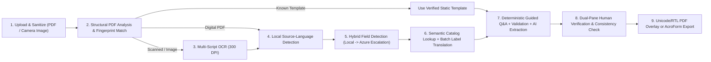

# AI & Document Processing Pipeline

This document specifies the end-to-end document ingestion, understanding, multilingual Q&A, LLM integration, and PDF generation architecture for **AI Form Assistant**.

---

## 1. End-to-End Processing Stages

---

## 2. Document Ingestion & Normalization (`app/documents/`)

| Format | Support Tier | Pipeline Behavior |
| :--- | :--- | :--- |
| **Digital AcroForm & Flat PDFs** | Production (v1.0) | Magic-byte `%PDF` check, empty-password decryption (`cryptography`), max `10 MB` / `20` pages, in-place neutralization of `/JavaScript`, `/OpenAction`, `/AA`, `/Launch`, and `/EmbeddedFiles`, SHA-256 checksum, private UUID object storage. |
| **Scanned Multi-Page PDFs** | Production (v1.0) | Routed automatically to `OCRService` (`300 DPI` render -> multi-script Tesseract `deu+eng+fra+ara+tur+ukr+spa`), never assuming `userLanguage == sourceLanguage`. |
| **Smartphone Camera Images (`JPG/PNG/WebP`)** | Commercial v1.0 (`Phase S1`) | Validated via `Pillow`, stripped of EXIF/GPS metadata, auto-oriented, and normalized into an A4 PDF at upload so all downstream OCR, detection, preview, and coordinate-overlay stages remain unified. |
| **DOCX** | Deferred (v1.3+) | Rejected cleanly with instructions to export as PDF first (avoids 600 MB headless LibreOffice attack surface for <2% of administrative volume). |

> [!WARNING]
> **Library Licensing Note:** `PyMuPDF` (`fitz`) is licensed under `GNU AGPL-3.0`. If the SaaS codebase is later made closed-source without a commercial Artifex license, replace the 4 `fitz` touchpoints with permissive-licensed `pypdfium2` (`Apache-2.0`/`BSD-3`), `pdfplumber` (`MIT`), `ReportLab` (`BSD-3`), and `pypdf` (`BSD-3`).

---

## 3. Document Understanding & Confidence Routing (`app/field_detection/`)

1. **Local-First Hybrid Detection (`HybridFieldDetectionProvider`):**
   - Runs `LocalFieldDetectionProvider` first at zero marginal cost (AcroForm widgets, vector boxes, ruled underlines, inline blank runs, checkbox/radio glyphs, table row indexing, and compound `Ort, Datum, Unterschrift` splitting).
   - Evaluates deterministic quality (`quality.py`) and coverage (`coverage.py`: label, selection-mark, and page coverage).
   - Escalates to `AzureDocumentIntelligenceProvider` (`prebuilt-layout`, capped at `HYBRID_MAX_ESCALATION_PAGES=10`) **only** when local score `< 0.55` or coverage floors fail and Azure is explicitly enabled.
2. **Deterministic Confidence Routing (Never LLM-Invented Confidence):**
   - `>= 0.75` (`FIELD_AUTO_CONFIRM_THRESHOLD`): Auto-usable in guided Q&A.
   - `0.40 – 0.74` (`FIELD_CLARIFICATION_THRESHOLD`): Included in guided Q&A with visual form-location preview badge; recorded for catalog review.
   - `< 0.40` or unmappable coordinates: Excluded from automatic writing and surfaced as a manual-completion notice on the Final Verification screen.

---

## 4. Structured State Machine vs. Autonomous Agent

AI Form Assistant deliberately uses a **backend-controlled deterministic state machine** (`SessionService` + `AnswerService`), **never** an autonomous LLM agent loop:
- **Predictability:** Official forms require 100% deterministic field coverage, repeatable ordering, and auditable state transitions.
- **Cost & Latency:** Choice fields, dates, booleans, emails, phone numbers, IBANs, and vector signatures execute with **zero LLM calls**.
- **Safety:** Changing a previously confirmed answer deterministically reopens or invalidates dependent fields without prompt drift.

---

## 5. LLM & Translation Provider Architecture (`app/ai/`, `app/translation/`)

### Security & Reliability Rules
1. **Header Authentication Only:** API keys (`x-goog-api-key`, `Ocp-Apim-Subscription-Key`, `Authorization: Bearer`) travel strictly in HTTP headers — never URL query parameters, never logged (`httpx` logger pinned to `WARNING`).
2. **Prompt Isolation:** System rules travel in `systemInstruction` / `system` role messages; untrusted user answers and document labels are passed as structured JSON/delimiters with minimal per-field context.
3. **Structured Output + Bounded Repair:** Every AI call uses `responseMimeType="application/json"` (or strict JSON Schema), validates against `ConfigDict(extra="forbid")` Pydantic schemas, and executes at most **1** deterministic JSON-repair retry before failing safely.
4. **Hybrid 6-Tier Question Resolution (`QuestionResolver`):**
   1. Approved reusable catalog question in `userLanguage`
   2. Approved reusable catalog question in `sourceLanguage`
   3. Immutable `FormVersion` static translation
   4. AI/Translator translation of approved source question (`pending_review`)
   5. AI generation from minimal field metadata (`pending_review`)
   6. Deterministic non-AI fallback
5. **Token & Cost Metering (`Phase S4`):** Every LLM/translation/OCR provider call records prompt tokens, completion tokens, characters, pages, latency, and micro-EUR cost in `ai_usage_events` with a hard per-session spend cap (`EUR 0.25`).
6. **MCP Evaluation:** Model Context Protocol (MCP) is **not** used for internal backend orchestration because Python service calls are faster, simpler, and strongly typed without JSON-RPC overhead.

---

## 6. PDF Generation & Honest Limitations of Flat / Scanned Forms (`app/pdf/`)

1. **Dual Export Engines:**
   - **Static Curated Templates (`PypdfRenderer`):** Fills mapped AcroForm fields across all pages (`READ_ONLY`) + renders vector signatures (`signature_render.py`).
   - **Dynamic Uploaded Documents (`dynamic_overlay.py`):** Maps confirmed answers back to `DetectedField.input_bounding_box`, draws vector checkmarks/signatures, masks dotted blank runs, strips empty interactive overlay widgets, and embeds Unicode/RTL fonts (`NotoSans` + `NotoSansArabic` in `Phase S1`).
2. **Known Limitations Surfaced to Users:**
   - Character-comb grids (`|A|B|C|`) on flat scans may not align character-by-character without explicit comb cell metadata.
   - Severe smartphone camera perspective skew (>5°) reduces overlay precision.
   - Overflowing values shrink down to a minimum readable `6.5pt` and flag a warning on the Verification Studio rather than silently truncating personal data.
   - Forms legally requiring *eigenhändige Unterschrift im Original* or Qualified Electronic Signature (`QES`) should use the built-in **"Sign on paper after printing"** option (`pending_manual_signature`).
