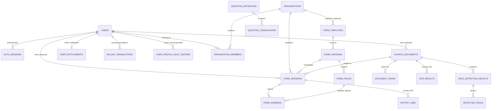

# AI Form Assistant — Database Design & Persistence Architecture

## 1. Design Principles

1. **Public vs. Internal Identifier Separation**:
   - Every externally addressable entity uses an internal integer `id` primary key for compact relational joins and foreign keys, paired with an indexed `public_id` (`UUID v4` / `String(36)`) exposed in URLs and API payloads. Sequential integer IDs are never exposed externally.
2. **Strict Multi-Language Separation**:
   - `source_language` (document/template language), `user_language` (guided question & explanation language), and `output_language` (rendered PDF output language) are persisted independently across templates, versions, sessions, and answers.
3. **Immutable Form Versioning**:
   - Published `form_versions` and their `form_fields` are immutable snapshots. Sessions bind to `form_version_id` so subsequent template edits never corrupt in-progress or historical sessions.
4. **Dual Ownership & Zero-Enumeration Security**:
   - Anonymous resources store only an `HMAC-SHA256` `ownership_token_hash` (never the raw token). Claiming a resource into an authenticated `users.id` atomically sets `user_id` and nulls `ownership_token_hash`.
5. **Privacy by Design & Automated Retention**:
   - Anonymous sessions, documents, and exports expire automatically (`expires_at`). Biometric signature stroke coordinates stay isolated inside `form_answers.normalized_value` (`original_answer = NULL`) and are never transmitted to AI or translation providers.

---

## 2. Verified Current Schema (17 Production Tables — Migrations `0001` through `b2c3d4e5f6a7` + Phases `S0`–`S1`)

| Domain | Table | Key Columns & Constraints | Lifecycle & Cascade Rules |
| :--- | :--- | :--- | :--- |
| **Forms** | `form_templates` | `id` (PK), `key` (UNIQUE), `default_source_language`, `status` | Root catalog record for predefined and dynamic templates. |
| **Forms** | `form_versions` | `id` (PK), `template_id` (FK `form_templates.id` CASCADE), `version_number`, `status`, `origin` (`predefined_template` \| `dynamic_detection`), `source_language`, `supported_output_languages` (JSON), `pdf_mapping` (JSON), `UNIQUE(template_id, version_number)` | Immutable once `status = 'published'`. Only `origin = 'predefined_template'` is listed in public `/api/published-forms`. |
| **Forms** | `form_fields` | `id` (PK), `version_id` (FK `form_versions.id` CASCADE), `key`, `field_type`, `position`, `required` (bool), `required_state` (`required` \| `optional` \| `unknown`), `labels` (JSON), `help_texts` (JSON), `options` (JSON), `configuration` (JSON), `UNIQUE(version_id, key)`, `UNIQUE(version_id, position)` | Stores semantic field metadata, `question_key`, page number, and normalized bounding box coordinates (`configuration.bounding_box`). |
| **Questions** | `question_definitions` | `id` (PK), `question_key` (UNIQUE), `field_type`, `status`, `configuration` (JSON) | Reusable semantic question catalog (`personal.first_name`, `address.postal_code`, etc.). |
| **Questions** | `question_translations` | `id` (PK), `question_definition_id` (FK CASCADE), `language`, `question_text`, `help_text`, `options` (JSON), `source`, `review_status` (`approved` \| `pending_review` \| `rejected`), `provider`, `model`, `prompt_version`, `UNIQUE(question_definition_id, language)` | Approved human/static translations take priority over AI translations. |
| **Sessions** | `form_sessions` | `id` (PK), `public_id` (UNIQUE UUID), `form_version_id` (FK RESTRICT), `source_document_id` (FK SET NULL), `user_id` (FK `users.id` SET NULL), `application_title`, `ownership_token_hash`, `user_language`, `output_language`, `status`, `current_field_position`, `total_required_fields`, `expires_at` | State machine: `session_created -> in_progress -> awaiting_final_confirmation -> ready_for_export -> completed` (+ `expired`, `cancelled`, `deleted`, `failed`). |
| **Answers** | `form_answers` | `id` (PK), `session_id` (FK `form_sessions.id` CASCADE), `field_id` (FK `form_fields.id` RESTRICT), `user_language`, `source_language`, `output_language`, `original_answer`, `normalized_value` (JSON), `output_value`, `status`, `validation_status`, `translation_status`, `requires_clarification`, `confirmed_by_user`, `uncertainties` (JSON), `revision`, `UNIQUE(session_id, field_id)` | Preserves raw `original_answer`, canonical `normalized_value`, and target `output_value` with revision tracking. |
| **Exports** | `export_jobs` | `id` (PK), `public_id` (UNIQUE UUID), `session_id` (FK `form_sessions.id` CASCADE), `idempotency_key`, `status`, `renderer_type` (`acroform` \| `coordinate_overlay`), `storage_key`, `mime_type`, `file_size`, `sha256_checksum`, `field_snapshot_hash`, `expires_at`, `UNIQUE(session_id, idempotency_key)` | Idempotent PDF generation record; expired artifacts are purged by cleanup jobs. |
| **Documents** | `source_documents` | `id` (PK), `public_id` (UNIQUE UUID), `user_id` (FK `users.id` SET NULL), `ownership_token_hash`, `original_filename`, `mime_type`, `file_size`, `page_count`, `sha256_checksum`, `storage_key`, `input_kind` (`acroform` \| `digital_text` \| `scanned` \| `mixed`), `detected_language`, `language_confidence`, `status`, `expires_at` | Uploaded PDF metadata. Anonymous uploads expire after TTL; user-claimed uploads (`user_id IS NOT NULL`) persist until deleted by owner. |
| **Documents** | `document_pages` | `id` (PK), `document_id` (FK `source_documents.id` CASCADE), `page_number`, `width_pt`, `height_pt`, `rotation`, `has_extractable_text`, `extracted_text`, `text_blocks` (JSON), `form_widgets` (JSON), `UNIQUE(document_id, page_number)` | Per-page PDF geometry, extracted text blocks, and AcroForm widget descriptors. |
| **Documents** | `ocr_results` | `id` (PK), `document_id` (FK CASCADE), `page_number`, `provider`, `language_hint`, `status`, `full_text`, `blocks` (JSON), `average_confidence`, `duration_ms` | Cached OCR extraction output per page. |
| **Detection** | `field_detection_results` | `id` (PK), `document_id` (FK CASCADE), `provider` (`local` \| `azure` \| `hybrid` \| `mock`), `model_id`, `prompt_version`, `status`, `source_kind`, `detected_language`, `quality_score`, `escalated`, `review_metadata` (JSON) | Aggregate field-detection run metadata and deterministic quality routing scores. |
| **Detection** | `detected_fields` | `id` (PK), `detection_result_id` (FK CASCADE), `field_key`, `label`, `field_type`, `page_number`, `bounding_box` (JSON `{x, y, width, height}`), `required` (bool), `required_state`, `confidence`, `source`, `options` (JSON), `configuration` (JSON), `review_state` | Normalized detected fields bridged into a `FormVersion` (`origin = 'dynamic_detection'`). |
| **Detection** | `provider_usage_records` | `id` (PK), `operation` (`field_detection` \| `translation` \| `ai_extraction`), `provider`, `model_id`, `document_id` (FK SET NULL), `page_count`, `character_count`, `token_count`, `cache_hit`, `duration_ms`, `success`, `error_code`, `provider_request_id`, `estimated_cost_usd` | Zero-PII operational telemetry and cost accounting table. |
| **Auth** | `users` | `id` (PK), `public_id` (UNIQUE UUID), `email` (UNIQUE normalized lowercase), `password_hash` (Argon2id), `role` (`user` \| `org_admin` \| `platform_admin`), `status` (`active` \| `disabled` \| `deleted`), `created_at`, `last_login_at` | Authenticated user accounts with RBAC role enforcement (`Phase S0`). |
| **Auth** | `auth_sessions` | `id` (PK), `public_id` (UNIQUE UUID), `user_id` (FK `users.id` CASCADE), `token_hash` (UNIQUE HMAC-SHA256), `expires_at`, `revoked_at`, `last_seen_at` | Server-revocable cookie sessions with rotation on `/api/auth/refresh`. |
| **Jobs** | `processing_jobs` | `id` (PK), `public_id` (UNIQUE UUID), `job_type`, `source_document_id` (FK `source_documents.id` CASCADE, indexed), `user_id` (FK `users.id` SET NULL, indexed), `status` (`queued` \| `running` \| `completed` \| `failed`), `stage`, `request_payload` (JSON), `result_payload` (JSON, transient tokens Fernet-encrypted), `error_code`, `created_at`, `started_at`, `completed_at`, `expires_at`, `INDEX(status, created_at)` | Durable async document preparation jobs (`Phase S1`, `202 Accepted` + `GET /api/jobs/{id}`). |

---

## 3. Target SaaS Schema Expansion (Phases `S1`–`S6`)

To support monetization, Stripe entitlements, Reusable Personal Vault pre-fill, B2B2C Association/Agency Portals, and GDPR compliance auditing without breaking existing tables, the following **8 tables** and **additive columns** are planned:

### 3.1 New SaaS Tables

| Phase | Table | Purpose & Key Columns | Constraints & Security |
| :--- | :--- | :--- | :--- |
| **`S2` Billing** | `user_entitlements` | Tracks active plan & remaining form credits: `id`, `user_id` (FK UNIQUE), `organization_id` (FK NULL), `plan_code` (`free` \| `single_pass` \| `pack_5` \| `pro_monthly` \| `org_starter` \| `org_growth`), `credits_remaining` (INT >= 0), `stripe_customer_id`, `stripe_subscription_id`, `subscription_status`, `current_period_end` | Row-level locking (`SELECT ... FOR UPDATE`) when decrementing `credits_remaining` on export unlock. |
| **`S2` Billing** | `billing_transactions` | Immutable ledger of purchases & credit redemptions: `id`, `public_id` (UUID), `user_id` (FK), `session_id` (FK NULL), `transaction_type` (`purchase` \| `redemption` \| `refund` \| `admin_grant`), `credits_delta` (INT), `amount_cents`, `currency` (`EUR`), `stripe_checkout_session_id`, `stripe_payment_intent_id`, `created_at` | Append-only financial audit trail; `UNIQUE(stripe_checkout_session_id)` prevents double credit grants. |
| **`S2` Billing** | `stripe_webhook_events` | Idempotent webhook deduplication: `id`, `stripe_event_id` (UNIQUE), `event_type`, `status` (`processed` \| `ignored` \| `failed`), `processed_at`, `error_code` | Guarantees at-most-once fulfilment on Stripe webhook retries; stores zero raw card/customer PII. |
| **`S4` Vault** | `user_profile_vault_entries` | Reusable canonical answers for 1-click pre-fill: `id`, `user_id` (FK CASCADE), `question_key` (`personal.first_name`, `address.city`, etc.), `encrypted_canonical_json` (BYTEA/TEXT), `value_language`, `updated_at`, `UNIQUE(user_id, question_key)` | Encrypted at the application layer (`Fernet` / AES-256-GCM envelope key `VAULT_ENCRYPTION_KEY`); never populated without user opt-in confirmation. |
| **`S5` Orgs** | `organizations` | B2B2C relocation agencies & migrant associations: `id`, `public_id` (UUID), `slug` (UNIQUE URL-safe), `name`, `logo_storage_key`, `default_languages` (JSON), `billing_email`, `status`, `created_at` | Powers branded `/org/[slug]` portals (`docs/association-document-portal.md`). |
| **`S5` Orgs** | `organization_members` | Multi-tenant staff membership: `id`, `organization_id` (FK CASCADE), `user_id` (FK CASCADE), `member_role` (`owner` \| `admin` \| `counselor`), `status`, `UNIQUE(organization_id, user_id)` | Every `/api/orgs/{slug}/*` endpoint enforces membership and role checks. |
| **`S1`/`S5` Audit** | `audit_events` | Tamper-evident security & compliance log: `id`, `actor_user_id` (FK SET NULL), `organization_id` (FK SET NULL), `action` (`session.claimed`, `export.unlocked`, `vault.deleted`, `account.erased`, `org.template_published`), `resource_type`, `resource_public_id`, `correlation_id`, `outcome`, `created_at` | Strictly excludes form answers, document contents, tokens, and PII (`AGENTS.md` Section 18). |
| **`S3` AI Ops** | `ai_prompt_evaluations` | Offline CI/staging benchmark runs: `id`, `suite_name`, `provider`, `model_id`, `prompt_version`, `fixture_count`, `pass_count`, `p95_latency_ms`, `total_cost_usd`, `created_at` | Tracks extraction/classification accuracy across model upgrades. |

### 3.2 Planned Additive Foreign Keys on Existing Tables

- `form_templates.organization_id` (`FK organizations.id NULL`, indexed): `NULL` = global platform template; non-null = private/portal template owned by a specific association or agency.
- `form_sessions.organization_id` (`FK organizations.id NULL`, indexed) & `form_sessions.export_unlocked` (`BOOLEAN NOT NULL DEFAULT FALSE`): Tracks portal attribution and whether unwatermarked PDF export is unlocked for the session.

---

## 4. Entity-Relationship Diagram

---

## 5. Data Retention, GDPR Right-to-Erasure & Migration Safety

### 5.1 Retention Policy Matrix

| Data Category | Anonymous User (`user_id IS NULL`) | Authenticated User (`user_id IS NOT NULL`) | Account Deletion (`DELETE /api/auth/account`) |
| :--- | :--- | :--- | :--- |
| **Uploaded Source PDF** (`source_documents` + object storage) | Hard-deleted after `SOURCE_DOCUMENT_TTL_HOURS` (`24h`) | Retained while application is active so re-edits & PDF re-exports work; hard-deleted immediately when user deletes the application | Immediate storage blob deletion + DB row cascade/purge |
| **Form Session & Answers** (`form_sessions`, `form_answers`) | Marked `expired` after `24h`; hard-purged after `7 days` | Retained until user deletes application (or configurable 12-month inactivity purge with 14-day email notice) | Immediate hard delete of `form_answers` & `form_sessions` |
| **Generated PDF Exports** (`export_jobs` + object storage) | Blob deleted after `EXPORT_TTL_HOURS` (`24h`) | Blob deleted after `7 days` (regenerable idempotently from confirmed answers) | Immediate blob & row deletion |
| **Personal Profile Vault** (`user_profile_vault_entries`) | Not available to anonymous sessions | Encrypted at rest; editable/deletable per field or all at once | Immediate cryptographic erasure |
| **Billing Ledger** (`billing_transactions`) | N/A | Retained for `10 years` per German commercial/tax law (*AO / HGB* GoBD) with `user_id` detached (`SET NULL`) upon account deletion | `user_id` set to `NULL`; zero form content ever stored in ledger |

### 5.2 Migration & Test Database Safety Rules

1. **Isolated Test Database Required**: Integration tests in `backend/tests/forms/test_forms.py` and `backend/tests/questions/test_questions.py` run `TRUNCATE TABLE form_templates CASCADE`. Automated tests **must** execute against `POSTGRES_DB=ai_form_assistant_test` and never against a developer's or staging environment's primary database.
2. **Expand-and-Contract Migrations**: Every production Alembic migration must be backward-compatible with the currently running container during rolling deployment (add nullable columns or columns with `server_default` first; backfill; add `NOT NULL` constraints in a follow-up release).
