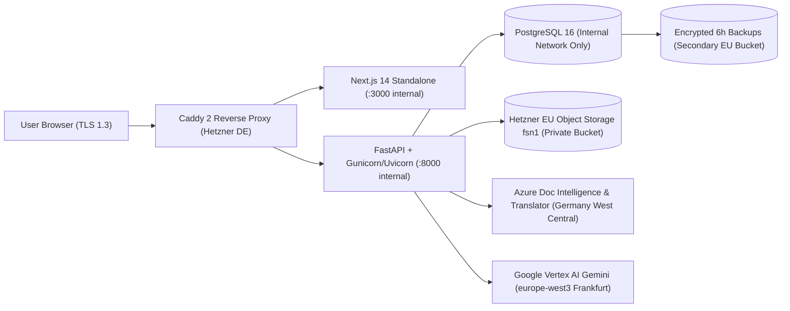
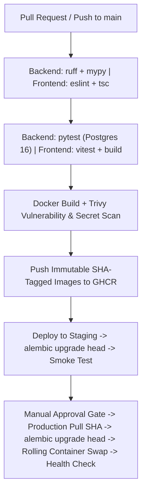

# AI Form Assistant — Production Deployment, Security & Operations Plan

## 1. EU-Sovereign Hosting Philosophy (GDPR-First, Solo-Founder Simple)

Because users upload identity, housing, tax, and family administrative documents, **EU data residency and zero-training guarantees** are non-negotiable product requirements — not optional enterprise add-ons. At the same time, as a solo developer, operational complexity (Kubernetes, multi-cluster service meshes) is an existential velocity trap.

The production architecture uses a **hardened single-node Docker Compose deployment on German infrastructure** for `0 -> 5,000 MAU`, with clean horizontal split points ready when measured load requires them.



---

## 2. Production Infrastructure Stack

| Layer | Production Choice | Region / Location | Rationale |
| :--- | :--- | :--- | :--- |
| **Primary Compute** | **Hetzner Cloud `CPX31`** (`4 vCPU`, `8 GB RAM`, `160 GB NVMe`) | Falkenstein (`fsn1`) or Nuremberg (`nbg1`), **Germany** | German GDPR jurisdiction, ISO 27001 data centers, `~EUR 16.50/mo`, ample CPU/RAM for PyMuPDF + FastAPI + Next.js + Postgres up to ~3,000 MAU. |
| **TLS & Edge Proxy** | **Caddy 2** (`caddy:2-alpine`) | Co-located container | Automatic Let's Encrypt TLS 1.3 + HTTP/3, zero-config renewal, HSTS, CSP/frame headers, request body limits (`12 MB` max on `/api/source-documents`), static security hardening. |
| **Application Runtime** | **Next.js 14 Standalone** + **FastAPI (`gunicorn -k uvicorn.workers.UvicornWorker -w 3`)** | Internal Docker bridge network | Non-root `appuser` containers; only ports `80/443` exposed on the host (`ufw` + Hetzner Cloud Firewall). |
| **Database** | **PostgreSQL 16** (`postgres:16-alpine`) | Dedicated Hetzner Volume (`ext4`, daily volume snapshots enabled) | Zero port exposure to public internet (`ports` omitted in `docker-compose.prod.yml`). |
| **Document & PDF Storage** | **Hetzner Object Storage (`fsn1`)** or **Cloudflare R2 (EU Jurisdiction)** | Germany / EU | S3-compatible private bucket (`StorageProvider` interface), server-side encryption, lifecycle auto-expiry for temporary blobs, presigned download URLs (`TTL <= 300s`). |
| **Cloud OCR & Translation** | **Microsoft Azure Document Intelligence + Azure Translator** | **Germany West Central (Frankfurt)** | EU data boundary, no customer data used for foundation model training, signed Microsoft DPA. |
| **Cloud LLM Extraction** | **Google Cloud Vertex AI (`gemini-2.5-flash`)** | **`europe-west3` (Frankfurt, Germany)** | Replaces consumer AI Studio key in production; covered by Google Cloud Data Processing Addendum with zero prompt logging/training retention. |
| **Payments** | **Stripe Checkout + Stripe Tax + Customer Portal** | EU Ireland entity | Zero raw card data touches our backend; automatic EU VAT calculation and invoice generation. |

---

## 3. Environments & Secret Management

| Environment | URL Pattern | AI / OCR Providers | Purpose |
| :--- | :--- | :--- | :--- |
| **Local Dev** | `http://localhost:3003` | `mock` or local `ollama` (opt-in cloud keys in untracked `.env`) | Fast feature development & local E2E runs (`ai_form_assistant` dev DB + `ai_form_assistant_test` pytest DB). |
| **CI Ephemeral** | GitHub Actions Runner | **`mock` strictly** (never calls paid APIs) | Runs on every PR and push (`ruff`, `mypy`, `pytest`, `vitest`, `tsc`, `playwright`, `trivy`). |
| **Staging** | `https://staging.formassistant.eu` (HTTP Basic Auth / Cloudflare Access gated) | Stripe Test Mode + EU Staging Bucket + Hybrid/Vertex Staging Project | Pre-production migration rehearsal, webhook verification, and visual PDF regression check. |
| **Production** | `https://app.formassistant.eu` | Live EU S3 + Vertex `europe-west3` + Azure `germanywestcentral` + Stripe Live | Customer-facing production environment. |

### Secret Hardening Rules (`Phase S0` Enforced)
1. When `APP_ENV=production` (`settings.is_production`), FastAPI refuses to boot unless:
   - `SESSION_TOKEN_SECRET` and `AUTH_SECRET` are explicitly set to distinct cryptographic secrets (`>= 32` characters, never matching dev fallbacks).
   - `AUTH_COOKIE_SECURE=true` and `ALLOWED_ORIGINS` contains only HTTPS production origins.
   - `NEXT_PUBLIC_ENABLE_DETECTION_DEBUG_UI` is unset or `false`.
2. Production secrets are injected via root-owned `0600` `/etc/ai-form-assistant/prod.env` on the host (managed via GitHub Actions Encrypted Environment Secrets during deploy) and never baked into Docker images or committed to Git.

---

## 4. CI/CD Pipeline & Zero-Downtime Release Flow



### Production Deploy Script (`deploy.sh` Summary)
1. Trigger pre-migration encrypted PostgreSQL snapshot (`pg_dump -Fc`).
2. Pull immutable image digest (`ghcr.io/oussamac10/ai-form-assistant-backend:<git-sha>` and `frontend:<git-sha>`).
3. Run `docker compose -f docker-compose.prod.yml run --rm backend alembic upgrade head`.
4. Recreate `backend` and `frontend` containers (`docker compose -f docker-compose.prod.yml up -d --remove-orphans`).
5. Poll `https://app.formassistant.eu/api/health` and `/api/health/database` (`200 OK` within `20s`).
6. Automatically invoke rollback if health checks fail.

---

## 5. Rollback Procedure (< 15 Seconds)

Every deployed image in GHCR is tagged with its exact immutable Git commit SHA (`IMAGE_TAG=<sha>`):

1. **Application Rollback (No Schema Breakage)**:
   ```bash
   IMAGE_TAG=<previous-verified-sha> docker compose -f docker-compose.prod.yml up -d backend frontend
   ```
   Completes in **10–15 seconds** because previous image layers remain cached locally on the NVMe volume.
2. **Database Migration Compatibility Guarantee**:
   - Because all migrations follow the **expand-and-contract** rule (additive columns/tables only during the active release), the `<previous-verified-sha>` backend remains 100% compatible with the migrated schema without running destructive `alembic downgrade` against live customer rows.
   - If a catastrophic data corruption ever occurs, restore from the pre-deploy `pg_dump` snapshot taken in Step 1 of `deploy.sh`.

---

## 6. Backup, Retention Cron & Disaster Recovery

1. **Encrypted Database Backups (Every 6 Hours)**:
   - Systemd timer runs `pg_dump -Fc ai_form_assistant | age -r <PUBLIC_KEY> > backup-$(date -u +%Y%m%dT%H%MZ).dump.age` and uploads to a **separate** EU bucket with Object Lock (`30-day` daily retention, `12-week` weekly retention).
   - **Monthly Restore Drill**: Automated script restores the latest `.dump.age` into a throwaway container and runs `SELECT count(*) FROM form_templates` + `alembic current` to verify backup integrity.
2. **Scheduled Privacy Cleanup Timers (Every Hour)**:
   - `python -m app.commands.cleanup_expired_sessions` (expires stale anonymous sessions).
   - `python -m app.commands.cleanup_expired_exports` (purges expired export PDFs and **anonymous-only** expired `source_documents`, never touching authenticated users' saved documents).

---

## 7. Observability, Error Monitoring & Cost Scaling

### 7.1 Zero-PII Telemetry Stack
- **Error Tracking**: **Sentry (EU Data Region `de.sentry.io`)** with `send_default_pii=False` and custom `before_send` scrubber stripping request bodies, cookies, `X-Session-Token`, and `x-goog-api-key` / `Ocp-Apim-Subscription-Key` headers.
- **Uptime & Synthetic Checks**: **BetterStack / Uptime Kuma** pinging `/api/health` and `/api/health/database` every `60s` with instant Telegram/Email/Slack alerts on non-`200` responses or TLS expiry `< 14 days`.
- **Cost & Provider Anomaly Alerts**: Daily SQL summary over `provider_usage_records` alerting if 24-hour cloud AI/OCR spend exceeds `EUR 10/day` or error rate exceeds `5%`.

### 7.2 Infrastructure Scaling & Monthly Cost Forecast

| Scale Milestone | Monthly Completed Forms | Infrastructure Topology | Compute + DB + Storage | AI + OCR Variable Spend | Total Monthly Tech Cost |
| :--- | :--- | :--- | :--- | :--- | :--- |
| **Launch (`100 MAU`)** | ~180 forms | Single Hetzner `CPX31` + EU S3 + Backups | EUR 26 | ~EUR 5 | **~EUR 31 / mo** |
| **Traction (`1,000 MAU`)** | ~1,800 forms | Hetzner `CPX41` (`8 vCPU, 16 GB RAM`) + Redis/ARQ worker container + EU S3 | EUR 48 | ~EUR 49 | **~EUR 97 / mo** |
| **Scale (`10,000 MAU`)** | ~18,000 forms | 2x App Nodes behind Hetzner LB + Managed/Dedicated Postgres (`CPX41` + replica) + Dedicated OCR/PDF Worker Node + EU S3 | EUR 210 | ~EUR 485 | **~EUR 695 / mo** |
