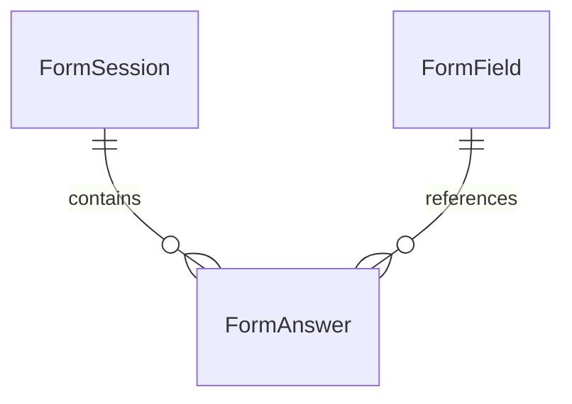

# Answer Data Model

This document outlines the data model and transitions for user-submitted form answers inside the multilingual AI Form Assistant.

## Entities

### FormAnswer
Represents a user's answer to a specific form field within an anonymous form session.
- `id` (UUID): Unique identifier.
- `session_id` (UUID): Reference to the parent session.
- `field_id` (UUID): Reference to the target form field.
- `original_answer` (Text): The raw, un-normalized, user-written text answer.
- `original_language` (String): ISO language code of the raw answer.
- `normalized_value` (JSON): Deterministically normalized language-independent canonical value (e.g. structured money dict or parsed date).
- `output_value` (Text, Optional): Translated text output formatted in the target output language.
- `status` (String): Q&A workflow status. One of:
  - `unanswered`: No answer provided yet.
  - `draft`: Validations failed or the answer is in progress.
  - `needs_clarification`: Missing attributes (e.g. currency/period for money fields).
  - `awaiting_confirmation`: Valid extraction ready for user confirmation.
  - `confirmed`: Formally confirmed by the user.
- `validation_status` (String): Validation results. One of:
  - `not_checked`: Has not been checked against Zod/deterministic logic.
  - `valid`: Fully matches required constraints.
  - `invalid`: Violates validation rules.
- `translation_status` (String): One of `not_required`, `pending`, `completed`, `failed`.
- `requires_clarification` (Boolean): Flag representing whether AI provider or system rules found missing fields.
- `confirmed_by_user` (Boolean): User agreement status.
- `confirmed_at` (DateTime, Optional): Timestamp when user confirmed.

## Constraints
- **Unique Answer per Field**: Enforced via a database-level unique constraint on `(session_id, field_id)`. Editing an answer updates the existing row rather than inserting a new one.
