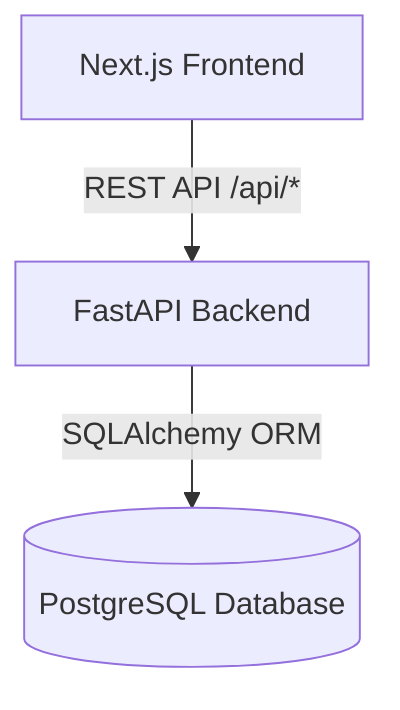

# Architecture Documentation

This document explains the architecture of the AI Form Assistant backend and frontend.

## System Overview

The system is a monorepo consisting of:
1. **Next.js Frontend**: Serves the user interface and proxies API requests.
2. **FastAPI Backend**: Implements the business logic, schemas, validation, and REST API.
3. **PostgreSQL Database**: Persistent storage for form templates, versions, fields, options, and temporary sessions.



---

## Backend Layers

The backend follows a clean, layered architecture organized into domain packages:

```
+-------------------------------------------------------------+
|                      API Routing Layer                      |
|       (app/api/*, app/forms/api/routes.py, sessions/api)    |
+-----------------------------+-------------------------------+
                              |
                              v
+-----------------------------+-------------------------------+
|                       Service Layer                         |
|           (app/forms/services.py, app/sessions/services.py)  |
+-----------------------------+-------------------------------+
                              |
                              v
+-----------------------------+-------------------------------+
|                     Repository Layer                        |
|   (app/forms/repositories.py, app/sessions/repositories.py) |
+-----------------------------+-------------------------------+
                              |
                              v
+-----------------------------+-------------------------------+
|                       Database Models                       |
|          (app/forms/models.py, app/sessions/models.py)      |
+-------------------------------------------------------------+
```

### 1. Database Models Layer (`models.py`)
Declares database entities mapped to Postgres tables using SQLAlchemy 2.0 type-safe `Mapped` and `mapped_column` annotations.

### 2. Repository Layer (`repositories.py`)
Separates persistence mechanics from business logic. Handles basic database queries and object creations.

### 3. Service Layer (`services.py`)
Contains the application's business rules and workflows (e.g., publishing check, cloning logic, configuration validation, session tokens hashing). Service methods are framework-agnostic and raise clean Python exceptions rather than FastAPI `HTTPException`.

### 4. API Routing Layer (`routes.py`)
Defines FastAPI endpoints, handles dependency injection (e.g., DB session), validates payloads with Pydantic, and returns JSON DTOs.

---

## Error Handling Pattern

To keep route handlers thin and business logic separate from HTTP concerns, exception handling is centralized in `backend/app/main.py` using global exception handlers:

- **ResourceNotFoundError** -> HTTP `404 Not Found`
- **StateConflictError** / **IntegrityError** -> HTTP `409 Conflict`
- **ValidationError** / **ConfigurationValidationError** -> HTTP `422 Unprocessable Entity`
- **UnauthorizedError** -> HTTP `401 Unauthorized` (used for invalid/missing session ownership tokens)
