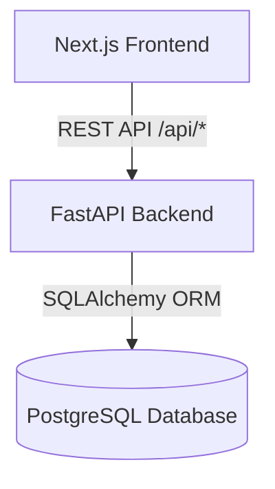

# Architecture Documentation

This document explains the architecture of the AI Form Assistant backend and frontend.

## System Overview

The system is a monorepo consisting of:
1. **Next.js Frontend**: Serves the user interface and proxies API requests.
2. **FastAPI Backend**: Implements the business logic, schemas, validation, and REST API.
3. **PostgreSQL Database**: Persistent storage for form templates, versions, fields, options, and temporary sessions.



---

## Backend Layers

The backend follows a clean, layered architecture organized into domain packages:

```
+-------------------------------------------------------------+
|                      API Routing Layer                      |
| (app/forms/api/routes.py, sessions/api, answers/api/routes) |
+-----------------------------+-------------------------------+
                              |
                              v
+-----------------------------+-------------------------------+
|                       Service Layer                         |
|   (app/forms/services.py, sessions/services, answers/serv)  |
+-----------------------------+-------------------------------+
                              |
                              v
+-----------------------------+-------------------------------+
|                     Repository Layer                        |
|  (app/forms/repositories, sessions/repos, answers/repos)    |
+-----------------------------+-------------------------------+
                              |
                              v
+-----------------------------+-------------------------------+
|                       Database Models                       |
|    (app/forms/models.py, sessions/models, answers/models)   |
+-------------------------------------------------------------+
```

### 1. Database Models Layer (`models.py`)
Declares database entities mapped to Postgres tables using SQLAlchemy 2.0 type-safe `Mapped` and `mapped_column` annotations.

### 2. Repository Layer (`repositories.py`)
Separates persistence mechanics from business logic. Handles basic database queries and object creations.

### 3. Service Layer (`services.py`)
Contains the application's business rules and workflows (e.g., publishing check, cloning logic, configuration validation, session tokens hashing). Service methods are framework-agnostic and raise clean Python exceptions rather than FastAPI `HTTPException`.

### 4. API Routing Layer (`routes.py`)
Defines FastAPI endpoints, handles dependency injection (e.g., DB session), validates payloads with Pydantic, and returns JSON DTOs.

---

## Error Handling Pattern

To keep route handlers thin and business logic separate from HTTP concerns, exception handling is centralized in `backend/app/main.py` using global exception handlers:

- **ResourceNotFoundError** -> HTTP `404 Not Found`
- **StateConflictError** / **IntegrityError** -> HTTP `409 Conflict`
- **ValidationError** / **ConfigurationValidationError** -> HTTP `422 Unprocessable Entity`
- **UnauthorizedError** -> HTTP `401 Unauthorized` (used for invalid/missing session ownership tokens)

---

## Frontend Architecture

The Next.js frontend is structured for localization, secure step-based workflow management, and responsive dynamic form presentation:

### 1. Route Layout & Localization
- **`LanguageProvider`**: Wrapped around the root layout, it dynamically sets the document language and direction (e.g., `dir="rtl"` and `lang="ar"` for Arabic) based on UI language choices, preserving selections in `localStorage`.
- **`next-intl`**: Handles static translation strings for headers, labels, placeholders, errors, and summaries using static translation assets (`en.json`, `de.json`, `fr.json`, `ar.json`).

### 2. Session Ownership and Security
- **`sessionCredentials` Service**: Manages `ownershipToken` mappings in `sessionStorage` isolated by browser tab.
- **Secure API Client (`apiClient.ts`)**: Appends the tab's `ownershipToken` using the `X-Session-Token` request header. It completely avoids URL token injection.

### 3. Automatic Upload-to-Questions Orchestration (Phase 13)

`app/field_detection/orchestration.py::PrepareQuestionsService` composes document analysis, OCR,
field detection, deterministic confidence routing, and question generation into one idempotent
call (`POST /api/source-documents/{id}/prepare-questions`). Normal users never drive OCR/detection/
review as separate manual steps; the frontend's `DocumentUploadForm` calls this endpoint
automatically after upload and navigates straight to the guided session. The Phase 11 manual
review screen (`FieldDetectionPanel`) is unchanged and still reachable directly for admin/debug
use — see [ADR 0012](decisions/0012-automatic-confidence-routing.md).

### 4. Workflow Routing & Dynamic Rendering
- **Guided Form Container (`/application/session/[sessionId]/page.tsx`)**: Integrates standard, clarification, and confirmation sub-flows based on backend answer state transitions.
- **`FieldRenderer` Component**: A unified entrypoint rendering appropriate input inputs for all 14 field types including:
  - Text: `string`, `person_name`, `country`, `money`
  - Numeric: `integer`, `decimal`
  - DateTime: `date`
  - Special: `email`, `phone` (with custom direction controls), `boolean` (custom Yes/No buttons), `address` (multi-line textarea)
  - Choices: `single_choice` (custom dropdown select), `multiple_choice` (checkbox list group)

