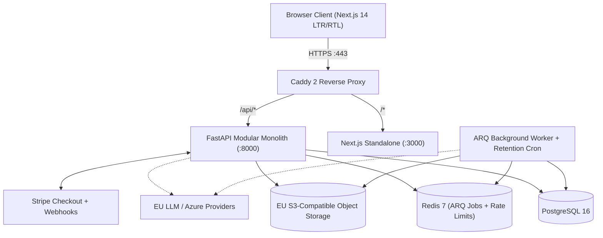

# Architecture Documentation (Current System & Production SaaS Target)

This document is the canonical architectural reference for **AI Form Assistant**, combining the verified implementation through **Phase 18** and **SaaS Phases `S0`–`S1`** (including ADRs `0001`–`0017`) with the **Production SaaS Modular Monolith** target architecture.

---

## 1. System Overview & Architectural Principles

AI Form Assistant is a **modular monolith** monorepo consisting of:
1. **Next.js 14 Frontend (`frontend/`):** App Router TypeScript UI supporting LTR and RTL layouts (`next-intl`), step-by-step guided sessions, live PDF field highlighting, digital vector signatures, and user dashboards.
2. **FastAPI Backend (`backend/app/`):** Domain-partitioned Python 3.11 service layer controlling workflow state, deterministic validation, hybrid document understanding, replaceable AI/OCR/translation/storage providers, and PDF export.
3. **PostgreSQL Database:** Source of truth for immutable form versions, semantic question catalogs, sessions, answers, accounts, provider usage records, and SaaS billing ledgers.
4. **Private EU Object Storage & Async Worker *(SaaS Production Layer)*:** Encrypted S3-compatible object storage (replacing local `/tmp` storage) and a Redis + ARQ background worker (running from the same backend container image) for non-blocking OCR/detection jobs and sliding-window rate limiting.

### Non-Negotiable Boundaries
- **Backend Owns Workflow State:** AI providers never decide field order, navigation, spending escalation, or auto-confirmation.
- **Three Independent Languages:** `source_language` (document), `user_language` (UI/questions), and `output_language` (completed PDF) remain distinct across every layer.
- **Deterministic Code Over AI:** Validation of dates, emails, phone numbers, IBANs, currencies, booleans, choice sets, and signature geometry is 100% deterministic.

---

## 2. Backend Layered Domain Structure

Every domain module follows strict four-layer separation:

```text
API Routing Layer (routes.py)        -> FastAPI DTO validation, auth/CSRF dependencies, HTTP status mapping
        │
        ▼
Service Layer (services.py)          -> Pure domain workflows, state transitions, ownership checks
        │
        ▼
Repository Layer (repositories.py)   -> Encapsulated SQLAlchemy 2.0 queries and persistence
        │
        ▼
Database Models (models.py)          -> Typed SQLAlchemy Mapped[...] ORM entities
```

### Centralized Exception Mapping (`backend/app/main.py`)
Services raise framework-agnostic domain exceptions mapped globally in `app/main.py`:
- `ResourceNotFoundError` / `DocumentNotFoundError` / `ApplicationNotFoundError` -> `404 Not Found`
- `StateConflictError` / `IntegrityError` / `AuthConflictError` -> `409 Conflict`
- `SummaryNotConfirmableError` -> `409 Conflict` with structured `missing_required_fields` and `invalid_answer_fields` (field keys and reason codes only — never private values or labels; see [ADR 0016](decisions/0016-three-state-requiredness-and-structured-confirmation.md))
- `ValidationError` / `DocumentValidationError` / `AuthValidationError` -> `422 Unprocessable Entity`
- `UnauthorizedError` / `DocumentUnauthorizedError` / `AuthUnauthorizedError` -> `401 Unauthorized` (generic message to prevent IDOR/account enumeration)
- `AuthForbiddenError` -> `403 Forbidden` (insufficient RBAC role)
- `RateLimitExceededError` -> `429 Too Many Requests` with `Retry-After` header (`app/core/rate_limit.py`)
- `AIProviderUnavailableError` / `OCRProviderUnavailableError` / `FieldDetectionProviderUnavailableError` -> `503 Service Unavailable`

---

## 3. Verified Core Subsystems & ADR Index

### 3.1 Immutable Form Versioning & Catalog Privacy (`app/forms/`, `app/questions/`)
- Published `FormVersion` rows are immutable; editing creates a cloned draft ([ADR 0001](decisions/0001-immutable-form-versions.md)).
- `FormVersion.origin` distinguishes curated `"predefined_template"` versions from user-uploaded `"dynamic_detection"` versions. Public catalog listings (`GET /api/published-forms`) expose **only** `"predefined_template"` versions so user-uploaded documents never leak across sessions, while administrative template/question write endpoints require `platform_admin` RBAC.
- Reusable questions resolve through a 6-step deterministic-first hierarchy (`QuestionResolver` in `app/questions/resolver.py`; [ADR 0005](decisions/0005-hybrid-question-resolution.md)).

### 3.2 Dual Session Ownership & Accounts (`app/sessions/`, `app/auth/`, `app/applications/`)
- Anonymous sessions use high-entropy tokens hashed at rest with HMAC-SHA256 (`SESSION_TOKEN_SECRET`) and passed exclusively via `X-Session-Token` ([ADR 0002](decisions/0002-anonymous-session-ownership.md), [ADR 0006](decisions/0006-frontend-session-state.md)).
- Authenticated accounts (`Phase 12`, [ADR 0011](decisions/0011-user-accounts-persistent-sessions.md)) use Argon2id password hashes, `HttpOnly` cookie sessions (`AUTH_SECRET`), token rotation, and double-submit `X-CSRF-Token` checks. Claiming an anonymous session (`POST /api/applications/claim`) atomically sets `user_id` and nulls `ownership_token_hash`.

### 3.3 Document Analysis, Camera Uploads, Storage, Async Jobs, OCR & Hybrid Detection (`app/documents/`, `app/storage/`, `app/jobs/`, `app/ocr/`, `app/field_detection/`, `app/language/`, `app/translation/`)
- **Pluggable Storage & Camera Image Normalization (`app/storage/`, `app/documents/image_normalizer.py`):** All uploaded documents and generated exports persist via `StorageProvider` (`LocalStorageProvider` backed by persistent volumes or `S3StorageProvider` using AWS Signature Version 4 over `httpx` for EU S3/Hetzner/R2). Uploaded smartphone photos (`JPG`, `PNG`, `WebP`) undergo magic-byte validation, `40 MP` decompression-bomb protection, `ImageOps.exif_transpose`, 100% EXIF/GPS metadata stripping via raw pixel reconstruction, and ISO A4 PDF wrapping before structural PDF analysis ([ADR 0008](decisions/0008-structural-pdf-document-analysis.md)).
- **Multi-Script OCR & Durable Async Jobs (`app/ocr/`, `app/jobs/`):** `LocalOCRProvider` runs multi-script Tesseract (`deu+eng+fra+ara+tur+ukr+spa`) independent of `userLanguage` ([ADR 0009](decisions/0009-local-ocr-provider.md)). Slow document preparation offloads to `ProcessingJob` (`202 Accepted` + `GET /api/jobs/{job_id}` polling + ARQ `WorkerSettings` in `app/jobs/worker.py`, with Fernet-encrypted transient session tokens at rest).
- **Hybrid Field Detection (`app/field_detection/`):** `HybridFieldDetectionProvider` runs `LocalFieldDetectionProvider` first, evaluates deterministic quality (`quality.py`) and coverage (`coverage.py`) floors, and escalates to `AzureDocumentIntelligenceProvider` (`<= 10` pages, cached by SHA-256 fingerprint) only below threshold ([ADR 0010](decisions/0010-dynamic-field-detection.md), [ADR 0012](decisions/0012-automatic-confidence-routing.md), [ADR 0013](decisions/0013-azure-document-intelligence-provider.md), [ADR 0017](decisions/0017-hybrid-local-first-field-detection.md)).
- **Language & Batch Translation (`app/language/`, `app/translation/`):** Detects `source_language` locally without external network calls, withholds identifiers (`protected.py`), batches unique labels/options by ID ([ADR 0014](decisions/0014-batched-translation-and-request-duration.md)), and backfills deferred output languages lazily ([ADR 0015](decisions/0015-translation-provider-and-azure-translator.md)).

### 3.4 Three-State Requiredness, Signatures, Unicode/RTL Fonts & Watermarked Preview (`app/answers/`, `app/pdf/`)
- **Requiredness vs. Answer State:** `FormField.requiredness` (`required | optional | unknown`) and `answer_state` (`unreached | unanswered | skipped | answered | invalid`) resolve orthogonally in `app/answers/states.py` ([ADR 0016](decisions/0016-three-state-requiredness-and-structured-confirmation.md)).
- **PDF Rendering & Watermarked Preview (`app/pdf/`):** Static templates fill AcroForm fields across all pages via `PypdfRenderer` ([ADR 0007](decisions/0007-explicit-pdf-template-mapping.md)); uploaded PDFs and non-WinAnsi Unicode AcroForm widgets embed bundled OFL `NotoSans-Regular.ttf` and `NotoSansArabic-Regular.ttf` (`Identity-H` Type0) via `font_support.py` (HarfBuzz contextual Arabic shaping, right-aligned RTL placement, mixed-script fallback spans, and crisp Cyrillic/Turkish diacritics). Users can inspect an ephemeral diagonal-watermarked preview (`GET /api/form-sessions/{session_id}/preview-pdf`) during review without creating `FormExport` rows.

---

## 4. Production SaaS Modular Monolith (11 Domain Modules)

To support commercial billing, durable storage, reusable profiles, and B2B2C Organization Portals without microservice sprawl, the monolith is organized into **11 bounded modules**:

| # | Module | Backend Package(s) | Responsibility |
| :- | :--- | :--- | :--- |
| 1 | **Identity & Users** | `app/auth/`, `app/profiles/`, `app/organizations/` | Auth cookies/CSRF, RBAC (`user`, `org_admin`, `platform_admin`), email verify/reset, Reusable Profile Vault, Organization memberships. |
| 2 | **Document Management** | `app/documents/`, `app/storage/` | PDF + camera-image ingestion, active-content sanitization, `StorageProvider` (Local / EU S3), retention & GDPR hard-purge. |
| 3 | **Document Extraction** | `app/ocr/`, `app/language/`, `app/field_detection/` | Async `prepare-questions` job orchestration, multi-script OCR, local language detection, hybrid local/Azure extraction. |
| 4 | **Form Schema & Templates** | `app/forms/`, `app/questions/` | Immutable versions, curated public catalog, Organization Portal forms (`/p/{slug}`), semantic `QuestionCatalog`. |
| 5 | **AI Conversation** | `app/ai/`, `app/translation/` | Replaceable `AIProvider` (`mock`, `ollama`, `gemini`, `openai_eu`) & `TranslationProvider`, versioned prompts, Pydantic schemas. |
| 6 | **Form Sessions & Answers** | `app/sessions/`, `app/applications/`, `app/answers/` | Guided Q&A state machine, skip/reopen, plain-language civic explanations, saved user applications. |
| 7 | **Validation** | `app/answers/validation/`, `app/answers/consistency.py` | Deterministic field validators + pre-export cross-field consistency warnings. |
| 8 | **Document Generation** | `app/pdf/` | AcroForm + coordinate-overlay PDF export with embedded Unicode/RTL Noto fonts, watermarked preview, and clean unlocked export. |
| 9 | **Subscription & Billing** | `app/billing/` | Stripe Checkout, Stripe Tax, Customer Portal, and idempotent `Stripe-Signature` webhook processing. |
| 10 | **Usage Metering** | `app/metering/` | Token/character/page cost ledger (`ai_usage_events`), `credit_ledger`, per-session cost caps, and Redis rate limiting. |
| 11 | **Admin & Monitoring** | `app/admin/`, `app/api/health.py` | Liveness/readiness probes, question/template review queue, unit-cost telemetry, and scheduled retention sweepers. |


