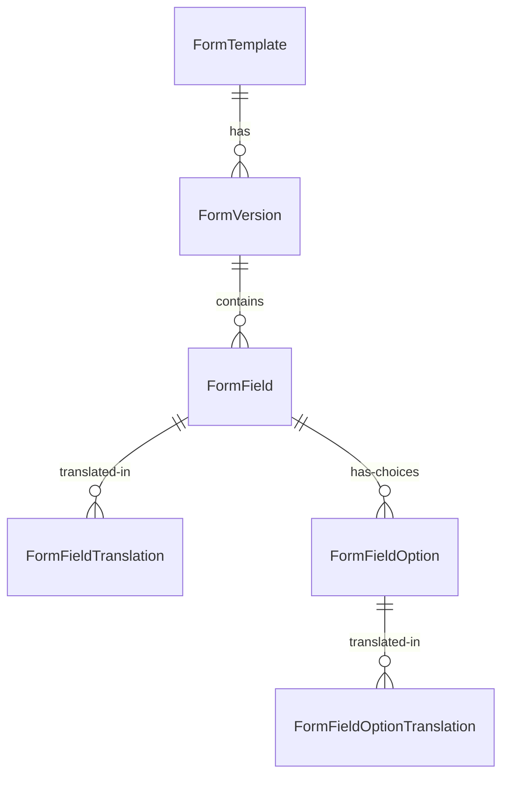

# Form Definitions Data Model

This document outlines the data model and versioning scheme for forms inside the multilingual AI Form Assistant.

## Entities

### FormTemplate
Represents a stable form identity.
- `id` (UUID): Unique identifier.
- `key` (String, Unique): Human-readable machine key (e.g. `basic-registration`).
- `name` (String): UI display name of the template.
- `description` (Text, Optional): Detail description.

### FormVersion
Represents a version of a form template.
- `id` (UUID): Unique identifier.
- `form_template_id` (UUID): Reference to the parent template.
- `version_number` (Integer): Incremental version starting at 1.
- `status` (String): Status of version (`draft`, `published`, `archived`).
- `source_language` (String): Language of original form.
- `supported_output_languages` (JSON list of strings): ISO codes of languages allowed for translation.

### FormField
Represents a question or input field inside a form version.
- `id` (UUID): Unique identifier.
- `form_version_id` (UUID): Reference to parent version.
- `key` (String): Unique field identifier within version.
- `field_type` (String): One of: `string`, `multiline_text`, `date`, `integer`, `decimal`, `money`, `boolean`, `single_choice`, `multiple_choice`, `email`, `phone`, `address`, `country`, `person_name`.
- `requiredness` (String): What the *document* declared. One of:
  - `required`: the form said so (AcroForm flag, adjacent asterisk, an explicit marker word, or a form-level "all fields are required" statement).
  - `optional`: the form said so ("Optional", "Facultatif", "Freiwillig", "اختياري", or a native flag).
  - `unknown`: the form said nothing. Never collapsed into either direction — it neither blocks the user nor claims the document made a statement it did not.
- `required` (Boolean): Legacy validation requirement, **derived** from `requiredness` (`required == (requiredness == "required")`) and kept in sync on every write. Not the source of truth: a boolean cannot express `unknown`, which is the ordinary case for a detected form.
- `position` (Integer): Ordering position.
- `configuration` (JSON): Validation constraints depending on field type.

### FormFieldTranslation
Stores localized field labels and helper text.
- `form_field_id` (UUID): Reference to parent field.
- `language` (String): ISO 639-1 code.
- `label` (String): Localized question label.
- `help_text` (Text, Optional): Guide text.
- `placeholder` (String, Optional): Inside-input placeholder.

### FormFieldOption
Stores choices for selection fields (`single_choice`, `multiple_choice`).
- `form_field_id` (UUID): Reference to choice field.
- `value` (String): Language-independent canonical value.
- `position` (Integer): Option sorting order.

### FormFieldOptionTranslation
Stores localized text for option values.
- `form_field_option_id` (UUID): Reference to option.
- `language` (String): ISO 639-1 code.
- `label` (String): Localized option label.

---

## Field Configurations

- **string** / **person_name**: Supports `minLength`, `maxLength`, `requiresConfirmation`.
- **integer** / **decimal**: Supports `minimum`, `maximum`, `requiresConfirmation`.
- **money**: Supports `allowedCurrencies` (ISO 4217 list), `minimum`, `maximum`, `requiresConfirmation`.
- **date**: Supports `minimumDate` (ISO 8601), `maximumDate` (ISO 8601), `requiresConfirmation`.
- **single_choice** / **multiple_choice**: Supports `requiresConfirmation`.
- All other types support: `requiresConfirmation`.

---

## State Transition Rules

1. A form version starts as a `draft` and can be edited freely.
2. A `draft` can be `published` if it satisfies all validation constraints:
   - At least one field is defined.
   - All fields have unique positions.
   - All fields have unique keys.
   - All fields have a translation for the `source_language` with a non-blank label.
   - All choice fields have at least one option.
   - Every choice option has a translation for all `supported_output_languages` + the `source_language`.
3. Once `published`, the version becomes **immutable**. Any mutation request on its fields or translations must be rejected.
4. Cloning a version (whether draft, published, or archived) creates a new version with an incremented version number in `draft` status, copying all fields, translations, and options independently.
