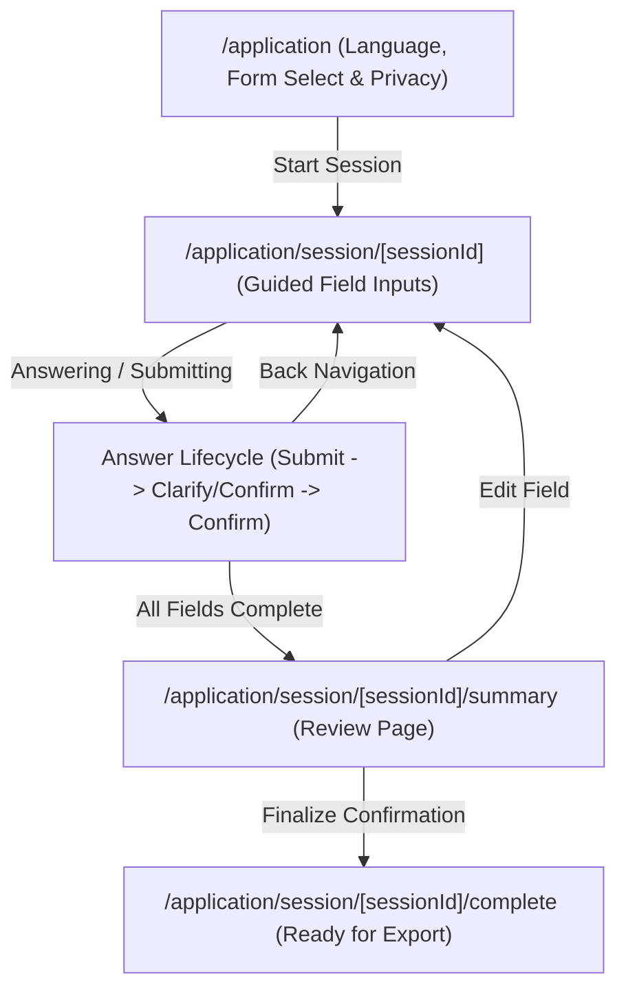

# Frontend Guided Flow Documentation

This document explains the frontend architecture, components, and user flows implemented in the AI Form Assistant (MVP Phase 7).

## Tech Stack
- **Framework**: Next.js 14 (App Router)
- **Styling**: Tailwind CSS & Vanilla CSS (glowing gradients, dark modes, interactive states)
- **State & Routing**: React, client-side route handlers, and state machines
- **Localization**: `next-intl` (English, German, French, Arabic RTL)
- **Validation & Parsing**: `zod` schema parsing for API responses

---

## User Flow Map

The user flow transitions sequentially through the following pages:



### 1. Landing and Form Selection (`/application`)
- User selects the UI language (EN, DE, FR, AR) and output language.
- User selects from the list of published forms.
- Explicit agreement to the privacy notice is required via a checkbox.
- Submitting creates an anonymous session on the backend and redirects the user.

### 2. Guided Field Screen (`/application/session/[sessionId]`)
- Retrieves the "current field" from the backend.
- Displays question label, help text, and placeholder in the selected UI language.
- Renders the appropriate component based on the field type (14 types supported).
- Renders progress percentage returned directly from the backend.

### 3. Answer Lifecycle & Confirmation
- **Submit Answer**: Users write their answer in their native tongue.
- **Clarification**: If the AI normalizer detects missing components (e.g., currency, frequency for money), it prompts the user using a localized sub-form while preserving their original text.
- **Confirmation**: Shows the original answer side-by-side with the proposed value, requiring explicit user confirmation.
- **Save & Advance**: Once confirmed, the backend calculates the next required field.

### 4. Summary Review (`/application/session/[sessionId]/summary`)
- Displays a table of all fields, original answers, proposed normalized values, and confirmation statuses.
- Allows editing any answer. Editing resets the confirmation state on the backend and redirects the user back to that field.
- Finale check verifies all required fields are complete before enabling finalization.

### 5. Export-Ready Screen (`/application/session/[sessionId]/complete`)
- Finalizes the summary.
- Alerts the user that no automatic submissions are made to external authorities.

---

## Key Components

### 1. `LanguageProvider`
Manages active locale, loads messages dynamically, and toggles RTL:
```typescript
document.documentElement.dir = locale === "ar" ? "rtl" : "ltr";
document.documentElement.lang = locale;
```

### 2. `sessionCredentials`
Safely manages anonymous token mapping:
- `setSessionToken(sessionId, token)`
- `getSessionToken(sessionId)`
- `removeSessionToken(sessionId)`
Ensures the ownership token is never exposed in client URLs.

### 3. `FieldRenderer`
A centralized dispatcher rendering components based on the 14 backend types:
- **Text**: `string`, `person_name`, `country`, `money` (free text input)
- **Numeric**: `integer`, `decimal` (numeric inputs)
- **DateTime**: `date` (date input)
- **Email/Phone**: `email`, `phone` (custom validations & directional controls)
- **Choices**: `single_choice` (select), `multiple_choice` (checkbox group)
- **Layouts**: `boolean` (Yes/No buttons), `multiline_text` / `address` (textarea inputs)
