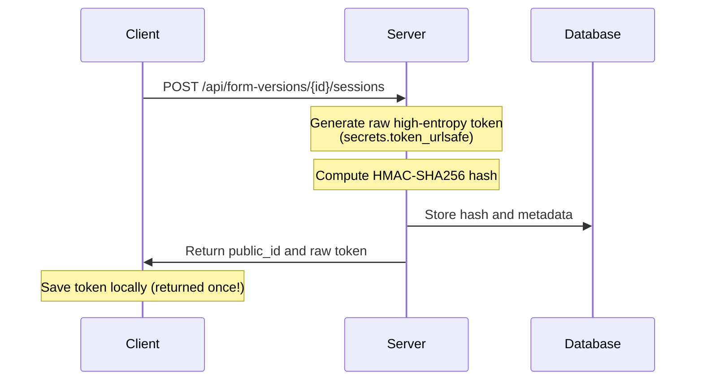
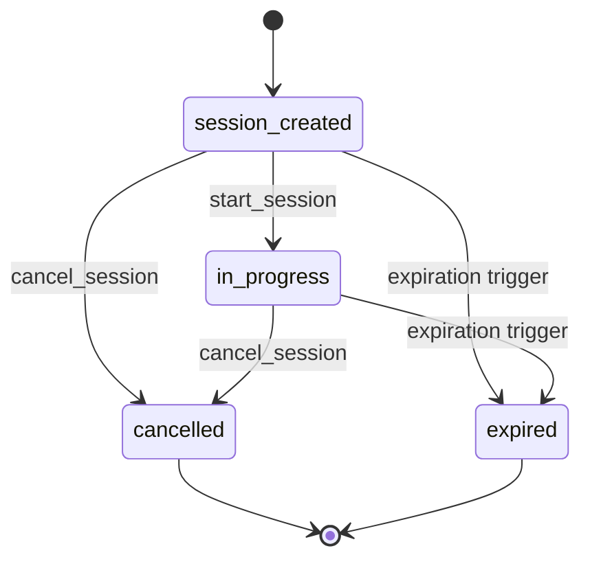

# Security Documentation & Controls

This document details the security model, cryptographic controls, and validation procedures implemented in the Form Sessions system.

## 1. Cryptographic Token Lifecycle

To protect anonymous sessions from hijacking, access is controlled via a secure token flow:

### Hashing at Rest
Raw tokens are **never stored** in the database. Instead, they are hashed using **HMAC-SHA256** keyed with a server-side secret (`SESSION_TOKEN_SECRET`):
- Any database compromise only reveals the token hashes, preventing attackers from reverse-engineering the raw tokens.
- Development environments fallback to a predefined unsafe secret, while production systems validate at startup that a high-entropy secret is configured.

### Safe Verification
When a request is received, the backend hashes the incoming header token and compares it to the stored hash using **constant-time string comparison** (`hmac.compare_digest`). This mitigates **timing attacks** that attempt to guess hashes character-by-character.

---

## 2. Session Authorization & Access Protection

- **Required Header**: All read or modify operations on active sessions require the `X-Session-Token` header.
- **Session Enumeration Mitigation**:
  - If a session does not exist, or the token is incorrect, the server returns a generic `401 Unauthorized` with the detail message `"Invalid session credentials"`.
  - The server **never** returns `404 Not Found` for invalid credentials. This prevents attackers from scanning or guessing public IDs to determine session existence.

---

## 3. Workflow State Transition Security

We enforce a strict, deterministic state machine for sessions:

- **Terminal States**: Once a session reaches a terminal state (`expired`, `cancelled`), it is locked permanently. No API requests can transition a terminal session back to active status.
- **Idempotency**: Transitioning to `cancelled` is safe to request multiple times; however, attempting to cancel an already cancelled session results in a controlled `409 Conflict`.

---

## 4. Answer Security & Validation Controls
- **Session State Enforcement**: Answers can only be submitted or modified while the session is strictly in `in_progress` status.
- **Field Context Verification**: The API validates that the requested field ID belongs to the active form version associated with the session. Requests targeting fields outside this version are rejected with a `422 Unprocessable Entity` validation error.
- **One Answer Per Field**: The database layer enforces a unique constraint `uq_session_field_answer` on `(session_id, field_id)`. Re-submitting or editing an answer overwrites the existing record in-place instead of creating duplicates.
- **Server-Side Validation**: All input normalization and validation occur deterministically on the backend to prevent bypasses or injections.
- **Final Summary Consistency**: The session finalization endpoint (`POST /confirm-summary`) double-checks that all required fields are confirmed, no errors exist, and no answers are in clarification states.

