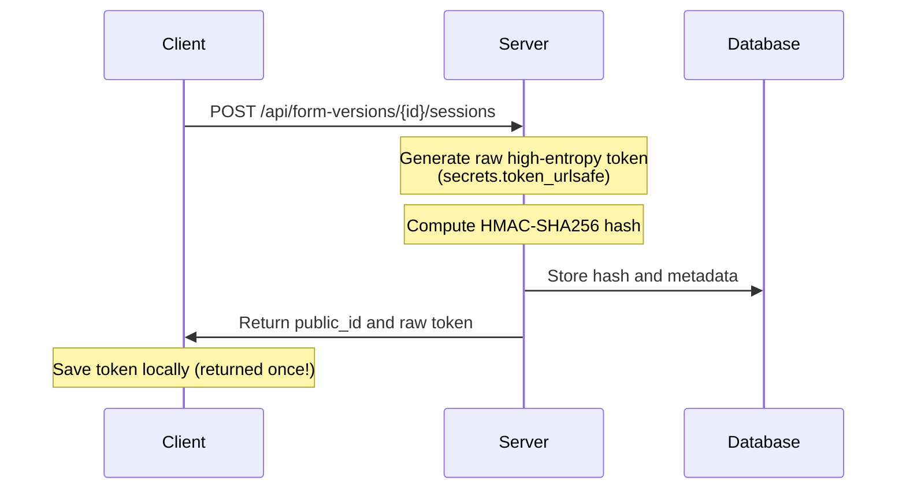
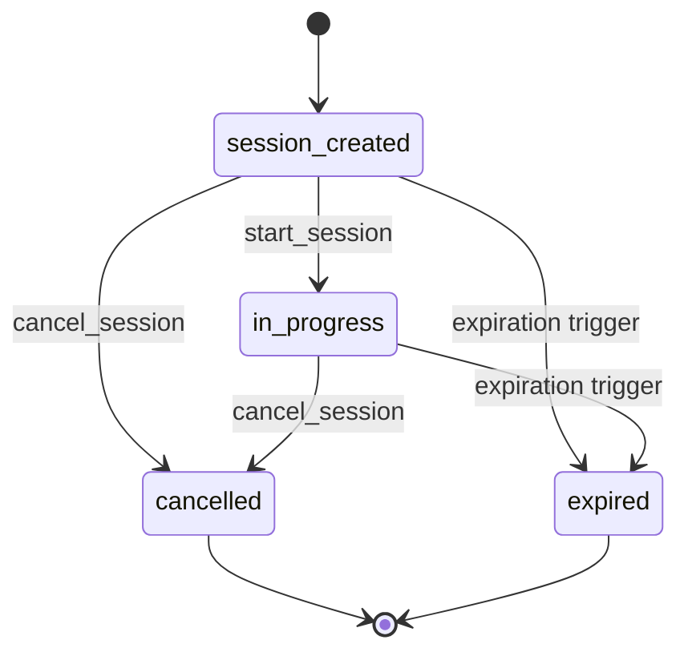

# Security Documentation & Controls

This document details the security model, cryptographic controls, and validation procedures implemented in the Form Sessions system.

## 1. Cryptographic Token Lifecycle

To protect anonymous sessions from hijacking, access is controlled via a secure token flow:

### Hashing at Rest
Raw tokens are **never stored** in the database. Instead, they are hashed using **HMAC-SHA256** keyed with a server-side secret (`SESSION_TOKEN_SECRET`):
- Any database compromise only reveals the token hashes, preventing attackers from reverse-engineering the raw tokens.
- Development environments fallback to a predefined unsafe secret, while production systems validate at startup that a high-entropy secret is configured.

### Safe Verification
When a request is received, the backend hashes the incoming header token and compares it to the stored hash using **constant-time string comparison** (`hmac.compare_digest`). This mitigates **timing attacks** that attempt to guess hashes character-by-character.

---

## 2. Session Authorization & Access Protection

- **Required Header**: All read or modify operations on active sessions require the `X-Session-Token` header.
- **Session Enumeration Mitigation**:
  - If a session does not exist, or the token is incorrect, the server returns a generic `401 Unauthorized` with the detail message `"Invalid session credentials"`.
  - The server **never** returns `404 Not Found` for invalid credentials. This prevents attackers from scanning or guessing public IDs to determine session existence.

---

## 3. Workflow State Transition Security

We enforce a strict, deterministic state machine for sessions:

- **Terminal States**: Once a session reaches a terminal state (`expired`, `cancelled`), it is locked permanently. No API requests can transition a terminal session back to active status.
- **Idempotency**: Transitioning to `cancelled` is safe to request multiple times; however, attempting to cancel an already cancelled session results in a controlled `409 Conflict`.

---

## 4. Answer Security & Validation Controls
- **Session State Enforcement**: Answers can only be submitted or modified while the session is strictly in `in_progress` status.
- **Field Context Verification**: The API validates that the requested field ID belongs to the active form version associated with the session. Requests targeting fields outside this version are rejected with a `422 Unprocessable Entity` validation error.
- **One Answer Per Field**: The database layer enforces a unique constraint `uq_session_field_answer` on `(session_id, field_id)`. Re-submitting or editing an answer overwrites the existing record in-place instead of creating duplicates.
- **Server-Side Validation**: All input normalization and validation occur deterministically on the backend to prevent bypasses or injections.
- **Final Summary Consistency**: The session finalization endpoint (`POST /confirm-summary`) double-checks that all required fields are confirmed, no errors exist, and no answers are in clarification states.

---

## 5. User Accounts (Phase 12)

### Password storage

Passwords are hashed with **Argon2id** (`argon2-cffi`) — never stored in plaintext or a reversible form. Verification failures (unknown account or wrong password) return the same generic `401` message so a caller cannot distinguish "no such account" from "wrong password" (account enumeration prevention). Registration with an email that already exists returns a generic `409 Conflict` for the same reason.

### Auth session cookies

A logged-in session is authorized by the same HMAC-SHA256-hash-at-rest token pattern as anonymous ownership tokens (Section 1), keyed with a separate `AUTH_SECRET`. The raw token is delivered only as an **HttpOnly**, `SameSite=Lax` cookie (`Secure` in production) — never readable by page JavaScript, never placed in a URL. `POST /auth/refresh` rotates the token (issues a new one, revokes the old), so a leaked older token stops working going forward. `POST /auth/logout` revokes the session immediately server-side.

### CSRF protection

Because the auth cookie is sent automatically by the browser, every cookie-authenticated mutation (`logout`, `refresh`, application rename/delete/claim) also requires a second, non-HttpOnly `csrf_token` cookie value to be echoed back as the `X-CSRF-Token` header (double-submit pattern). A third-party page cannot read the cookie to forge this header. This check only applies once an auth cookie is present — it does not affect the anonymous, token-header-authenticated flow at all.

### CORS

`ALLOWED_ORIGINS` (`app/core/config.py`) is an explicit origin allowlist. A wildcard origin cannot be combined with `allow_credentials=True` per the CORS specification — browsers reject it outright — so a specific list is required now that auth relies on cookies.

### Dual ownership authorization

`FormSession`/`SourceDocument` each carry an optional `user_id` alongside the existing (now-nullable) `ownership_token_hash`. Exactly one is ever meaningful for a given resource: if `user_id` is set, only that authenticated user may access it and the token is never consulted again; otherwise, the original anonymous-token check applies unchanged. The same generic `401` is returned for every failure combination (missing resource, wrong token, wrong user), preserving the existing no-enumeration guarantee.

### Claiming an anonymous application

`POST /applications/claim` verifies the anonymous ownership token, then — in one transaction — sets `user_id` and clears `ownership_token_hash` to `NULL`, permanently invalidating the old token. The operation is idempotent for the same user and rejected (generic `401`) for a different one, matching the rest of this document's IDOR-prevention pattern. See ADR 0011 for the full rationale.

